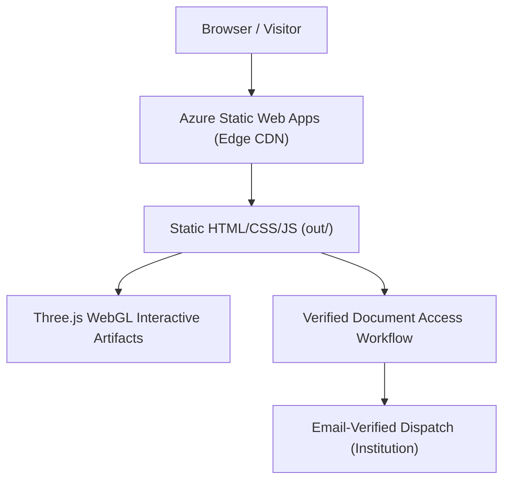

# Muhammad Kamran Ashraf
### MPhil Physical Chemistry Researcher & Computational Scientist
**Quaid-i-Azam University (QAU), Islamabad**  
Supervisor: **Prof. Dr. Safeer Ahmed**

---

## 🌟 Overview
This repository contains the official portfolio web application of **Muhammad Kamran Ashraf**, postgraduate researcher in Physical & Computational Chemistry at Quaid-i-Azam University (QAU), Islamabad.

Built with an editorial aesthetic and high performance:
- **Framework**: Next.js 14 (App Router) with static HTML export (`output: 'export'`)
- **Graphics Engine**: Three.js / React Three Fiber interactive 3D WebGL orbital and system artifacts
- **Styling**: Tailwind CSS with custom editorial typography and dark mode palettes
- **Deployment**: Microsoft Azure Static Web Apps with continuous GitHub Actions CI/CD
- **Content Architecture**: Separation of concerns via validated JSON content stores (`content/*.json`)

---

## 🏗️ Architecture & Deployment



- **Zero-Serverless Attack Surface**: Fully compiled static HTML export eliminates cold starts, database vulnerabilities, and unauthenticated data leaks.
- **Dynamic 3D WebGL Isolation**: Three.js canvases are wrapped with `IntersectionObserver` to automatically pause rendering when offscreen, preventing WebGL context exhaustion and saving mobile battery.
- **Confidential Vault Security**: Confidential pre-publication manuscripts, structural models, and official academic certificates are watermarked and distributed exclusively via verified email dispatch.

---

## 🔬 Research & Academic Domains

### 1. Reverse-Chronological Academic Trajectory
- **2025 – Present**: MPhil Physical Chemistry at Quaid-i-Azam University, Islamabad. Supervised by Prof. Dr. Safeer Ahmed. Specializing in computational electrocatalysis, surface kinetics, and DFT modeling of bifunctional energy materials.
- **2024 – 2025**: Chemistry Teacher at Unique Science Academy, Lahore.
- **2020 – 2024**: BS (Hons) Chemistry at School of Chemistry, University of the Punjab (PU, Lahore). Capstone project in functionalized biopolymeric sorbents and green-synthesized metal oxides.
- **2020 – 2022**: Associate Degree in Science (ADS) at Govt. Postgraduate College, Okara / PU.
- **2019 – 2022**: Science Teacher at The Educators (Beaconhouse System), Noor Campus, Okara.

### 2. Core Research Focus Areas
- **Bifunctional Electrocatalysis**: Overpotential reduction and electronic modulation for alkaline ORR/OER air electrodes.
- **Density Functional Theory (DFT)**: Quantum ESPRESSO electronic structure calculations, slab models, and reaction intermediate free energy profiles.
- **Secondary Zinc–Air Energy Systems**: Decoupling cathode and anode degradation pathways under standardized electrochemical protocols.
- **Scientific Software & Automation**: High-throughput academic research pipelines, literature harvesters, and custom desktop utilities.

### 3. Confidential Document Access
Official degree certificates, transcripts, and pre-publication manuscripts are watermarked and shared with verified institutional reviewers upon request through the interactive Confidential Vault workflow on the site.

---

## 🚀 Local Development Setup

### Prerequisites
- Node.js 18+ (tested with Node 20 / 22)
- npm or pnpm

### Quickstart
```bash
# 1. Clone repository
git clone https://github.com/Kamran5H/Portfolio.git
cd Portfolio

# 2. Install dependencies
npm install

# 3. Validate content integrity
npm run content:check

# 4. Start local development server
npm run dev
```

Visit [http://localhost:3000](http://localhost:3000) to view the live web application.

---

## 🛠️ Content Management & Lifetime Maintenance

All textual content, projects, and lab tools are decoupled from React components:
- **`content/site.json`**: Name, bio, tagline, socials, educational trajectory, and technology stack.
- **`content/projects.json`**: Flagship systems, live links, GitHub repos, and associated 3D models.
- **`content/lab.json`**: Micro-tools, automation scripts, and private tool status.
- **`content/vault.json`**: Registered academic credentials and restricted research files.

Validate syntax at any time:
```bash
npm run content:check
```

---

## ☁️ Continuous Deployment (CI/CD)

Automated deployment is configured via `.github/workflows/azure-static-web-apps.yml` using Azure Static Web Apps:
- **Build Command**: `npm run build`
- **Output Directory**: `out`
- **Configuration**: `staticwebapp.config.json` with hardened security headers (HSTS, nosniff, SAMEORIGIN).

---

## 👨‍🔬 Contact & Profiles
- **Scholar**: Muhammad Kamran Ashraf ([chkamran32b@gmail.com](mailto:chkamran32b@gmail.com))
- **Research Supervisor**: Prof. Dr. Safeer Ahmed (`safeerad@qau.edu.pk`)
- **Institution**: Department of Chemistry, Quaid-i-Azam University, Islamabad, Pakistan
- **ORCID**: [0009-0003-2997-2954](https://orcid.org/0009-0003-2997-2954)
- **GitHub**: [https://github.com/Kamran5H](https://github.com/Kamran5H)
- **LinkedIn**: [https://www.linkedin.com/in/kamran-ashraf-762a21363/](https://www.linkedin.com/in/kamran-ashraf-762a21363/)
